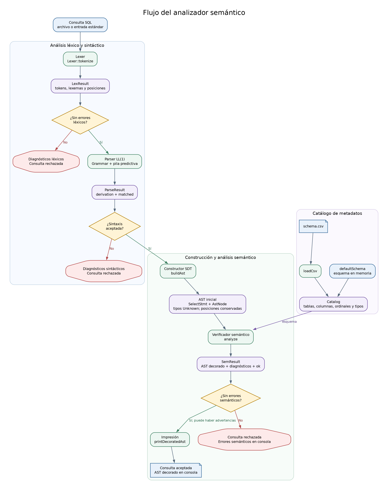
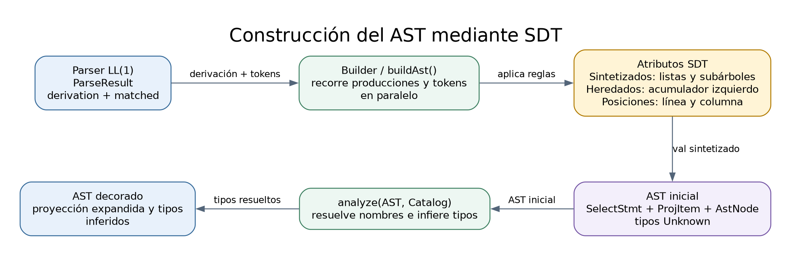
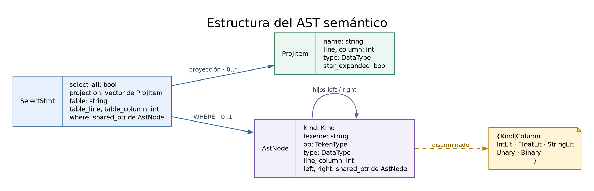
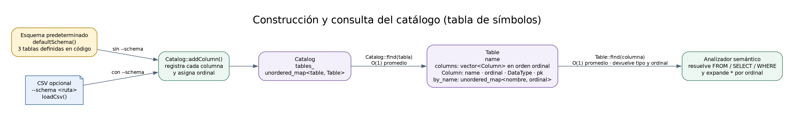

# Informe técnico — Práctica de Laboratorio 6

## Analizador semántico, tabla de símbolos y construcción del AST

**Práctica 6 · Fase 2 · Compiladores SQL**

**Curso:** Estructuras de Datos Avanzadas<br>
**Escuela:** Escuela Profesional de Ciencias de la Computación<br>
**Integrantes:** [Completar nombres y códigos]<br>
**Docente:** [Completar]<br>
**Fecha:** [Completar]

> Informe técnico del módulo implementado en C++ para la Práctica 6. Describe el catálogo,
> la traducción dirigida por la sintaxis, el AST, las reglas semánticas, las pruebas y las
> decisiones de alcance. La especificación completa de atributos está en
> [SDT.md](SDT.md); la gramática LL(1) está en [../parser_ll1/grammar.md](../parser_ll1/grammar.md).
> Se elaboró siguiendo el [enunciado de la práctica](../../docs/EDA_Lab06.md).

### Contenido

[Resumen](#resumen) · [Introducción](#introducción) · [Arquitectura](#2-alcance-y-arquitectura) ·
[1. Diseño SDT y AST](#1-diseño-del-sdt-y-ast) · [2. Tabla de símbolos](#2-tabla-de-símbolos) ·
[3. Analizador semántico](#3-analizador-semántico) · [4. Manejo de errores](#4-manejo-de-errores-semánticos) ·
[5. Pruebas](#5-batería-de-pruebas) · [6. Informe PDF](#6-informe-pdf-y-evidencias)

## Resumen

Se implementó una etapa de análisis semántico para consultas `SELECT`. El flujo integra el
lexer, el parser predictivo LL(1), la construcción del AST a partir de la derivación y la
validación del árbol contra un catálogo de metadatos. La etapa comprueba tablas y columnas,
expande `SELECT *`, verifica tipos en `WHERE` e imprime el AST decorado cuando la consulta
es válida. El análisis se limita a metadatos: no lee registros ni páginas de datos.

### Estado frente al enunciado

| Área | Estado | Evidencia / precisión |
|---|---|---|
| Diseño SDT y AST | Cumple | Este informe describe los atributos, las acciones por producción y la estructura implementada; `SDT.md` conserva el detalle completo. |
| Catálogo y tabla de símbolos | Cumple parcialmente | Consultas promedio O(1), tres tablas y tipos requeridos. El nombre de tabla funciona como identificador lógico; no se almacena una ruta física independiente. |
| Estructura del AST | Cumple con adaptación documentada | Se usa `AstNode` etiquetado por `Kind` y estructuras `SelectStmt`/`ProjItem`, en lugar de una jerarquía de subclases. |
| Validación semántica | Cumple según las reglas documentadas | Resuelve nombres, expande `*`, comprueba tipos y exige condiciones booleanas. |
| Diagnósticos y pruebas | Implementados; aserciones parciales | El CLI muestra causa y posición. No todos los tests comprueban explícitamente el mensaje y la ubicación de cada diagnóstico. |
| Informe | Fuente en Markdown | El enunciado exige entregar PDF en el repositorio y en el aula virtual. Este archivo es la fuente Markdown; debe exportarse a PDF para completar ese entregable. |

> **Resultado de pruebas:** 16/16 suites CTest aprobadas en la verificación registrada en este informe.

## Introducción

El análisis semántico verifica que los nombres y las operaciones de una consulta tengan
sentido de acuerdo con el esquema de la base de datos. Así, conecta el análisis sintáctico
con las futuras fases de planificación y ejecución, y evita que consultas con tablas,
columnas o tipos inválidos avancen en el proceso.

En esta práctica, el lexer y el parser LL(1) se integran con un catálogo de metadatos y un
constructor de AST que aplica Traducción Dirigida por la Sintaxis (SDT). El verificador
resuelve tablas y columnas, expande `SELECT *` y comprueba los tipos de las expresiones de
`WHERE`. Si la consulta es válida, imprime el AST decorado. El análisis se limita al
esquema: no lee registros ni páginas de datos y tampoco ejecuta la consulta.

## 1. Contexto y objetivos

El proyecto desarrolla progresivamente un motor de almacenamiento para consultas SQL. La
Práctica 6 continúa el analizador léxico de la Práctica 4 y el parser LL(1) de la Práctica
5. Su propósito es determinar si una consulta sintácticamente correcta tiene sentido
respecto del esquema conocido, antes de una futura etapa de planificación o ejecución.

Los objetivos de esta implementación son:

- Mantener metadatos de tablas y columnas en un catálogo consultable.
- Construir un AST a partir de las producciones aplicadas por el parser, usando SDT.
- Resolver identificadores y validar los tipos de las expresiones de `WHERE`.
- Mostrar el AST con tipos inferidos o reportar diagnósticos con ubicación.
- Evitar que el análisis semántico se ejecute después de un error léxico o sintáctico.

## 2. Alcance y arquitectura

El analizador opera sobre el esquema, no sobre datos almacenados. La palabra «disco» en el
proyecto corresponde a etapas posteriores; aquí no se leen páginas ni se evalúan
predicados contra filas.



**Cómo leer el flujo:** el lexer produce tokens con sus posiciones; el parser LL(1) consume
esos tokens y registra la derivación y los tokens emparejados. Solo una consulta que supera
ambas etapas llega a `buildAst()`. El constructor SDT crea el árbol con posiciones y tipos
inicialmente `Unknown`; luego `analyze()` consulta el catálogo, resuelve nombres e infiere
tipos. `SemResult::ok` permanece verdadero si solo hay advertencias, por lo que el CLI puede
imprimir el AST decorado; los errores léxicos, sintácticos o semánticos terminan en rechazo.
El ejecutable `semantic` coordina estas etapas, mientras que el catálogo entra al análisis
como una fuente de metadatos independiente de la consulta.

## 1. Diseño del SDT y AST

### 1.1. Diseño de la Traducción Dirigida por la Sintaxis (SDT)

El parser LL(1) produce `ParseResult::derivation` (producciones aplicadas) y
`ParseResult::matched` (tokens reconocidos en orden). Solo si el resultado sintáctico es
válido, `buildAst()` recorre ambas secuencias en paralelo. Cada método `build*` implementa
las acciones semánticas de un no terminal y devuelve su atributo sintetizado: una lista,
un token operador o un subárbol. Las colas recursivas reciben el acumulador izquierdo como
atributo heredado, lo combinan con el siguiente operando y así conservan asociatividad a la
izquierda. Cada nodo retiene la línea y columna del token que lo origina.



Resumen de atributos y acciones semánticas:

| Producciones | Atributos y acción semántica |
|---|---|
| `consulta`, `proyeccion`, `lista_cols`, `cols_tail` | Sintetizan el `SelectStmt`, la tabla y la lista de `ProjItem`. `STAR` activa `select_all`; los identificadores de columnas guardan nombre y ubicación. Las colas añaden elementos hasta `ε`. |
| `where_opt`, `condicion` | Sintetizan la raíz de la condición, o un puntero nulo si `where_opt → ε`. |
| `disy`, `disy_tail` (`OR`) | Sintetizan la expresión lógica. `disy_tail` hereda el acumulador izquierdo y crea `Binary(OR, izquierda, conj.val)`; en `ε`, devuelve ese acumulador. |
| `conj`, `conj_tail` (`AND`) | Aplican el mismo esquema heredado para `AND`, con mayor precedencia que `OR`. |
| `comp`, `comp_tail`, `op_comp` | Conservan el operando si la cola es `ε`; si hay operador, sintetizan `Binary(op, izquierda, derecha)`. La gramática permite una comparación por expresión. |
| `suma`, `suma_tail` (`+`, `-`) y `prod`, `prod_tail` (`*`, `/`) | Sintetizan nodos binarios. Cada cola pasa el árbol acumulado como atributo heredado, produciendo asociación a la izquierda y respetando precedencia aritmética. |
| `unario → MINUS unario` / `unario → primario` | Sintetiza `Unary(-, hijo)` con la posición del signo, o propaga el atributo del primario. |
| `primario` (identificador, literal o paréntesis) | Sintetiza hojas `Column`, `IntLit`, `FloatLit` o `StringLit` con lexema y ubicación. Los paréntesis propagan el árbol interno sin crear un nodo. |

Los atributos `.val` de expresiones son subárboles sintetizados; `izquierda` es el atributo
heredado que acumulan las colas recursivas. Los operadores y nodos conservan la posición
del token que los origina. La construcción SDT no asigna tipos finales: el AST sale con
tipo `Unknown`; luego `analyze()` consulta el catálogo, resuelve columnas, expande `*` e
infiere los tipos. La tabla completa producción por producción está en [SDT.md](SDT.md).

### 1.2. Estructura del AST

La gramática establece la precedencia `OR`, `AND`, comparación, suma/resta,
multiplicación/división y negación unaria, de menor a mayor. Los paréntesis agrupan las
expresiones según las producciones de la gramática.



`AstNode::type` comienza como `Unknown` y el analizador lo completa durante la inferencia.
Los nodos incluyen columnas, literales enteros/decimales/cadenas, negación unaria y
operaciones binarias aritméticas, relacionales o lógicas. `SelectStmt` conserva la tabla,
la proyección y el `WHERE` opcional. El diagrama representa las estructuras reales: el
código usa un `AstNode` etiquetado mediante `Kind`, no clases derivadas como `ColumnNode` o
`BinaryExprNode`.

## 2. Tabla de símbolos

El catálogo (`Catalog`) indexa tablas con `std::unordered_map`; cada `Table` conserva sus
columnas en un vector ordenado e incluye otro mapa para localizar columnas por nombre. Las
búsquedas tienen costo promedio O(1) por tabla y por columna. El ordinal comienza en cero y
corresponde al orden de inserción, que también se usa al expandir `*`.

**Quién construye y carga la tabla de símbolos:** `Catalog` posee las estructuras que
almacenan e indexan los metadatos y `Catalog::addColumn()` registra columnas y crea las
tablas cuando hace falta. En la ruta predeterminada, el esquema de prueba está hardcodeado
en `defaultSchema()`: sus llamadas a `addColumn()` declaran manualmente las tres tablas y
sus columnas en memoria. `semantic_cli.cpp` usa esa función si no se proporciona
`--schema`. Como alternativa, con `--schema <ruta>` el CLI llama a `loadCsv()`, que lee el
archivo y puebla el mismo tipo de `Catalog` mediante `addColumn()`. Por tanto, el esquema
predeterminado no se descubre automáticamente ni se obtiene de una base de datos; el CSV
permite cambiarlo al ejecutar el programa. Las pruebas también pueden crear catálogos
directamente mediante la API.



Flujo de construcción y uso:

- `semantic_cli` elige la fuente: usa `defaultSchema()` si no recibe `--schema`, o llama a
  `loadCsv()` si se proporciona una ruta CSV.
- La fuente entrega los metadatos columna por columna mediante `Catalog::addColumn()`.
- Al procesar la primera columna de una tabla, `addColumn()` accede a `tables_[nombre]`;
  si la entrada aún no existe, el mapa crea el objeto `Table`. Luego se asigna el nombre de
  la tabla y se registra esa columna con su ordinal.
- Las llamadas siguientes para esa tabla encuentran la entrada existente y agregan las
  demás columnas, manteniendo su orden y el índice `by_name`.
- Con el catálogo poblado, el analizador busca la tabla y después sus columnas. Para
  `SELECT *`, recorre el vector ordenado y conserva el orden ordinal.

El esquema de prueba está disponible en memoria mediante `defaultSchema()` y en
[`schema.csv`](schema.csv). Contiene tres tablas y tipos variados:

| Tabla | Columnas en orden (tipo) |
|---|---|
| `estudiantes` | `id` (INT, PK), `nombre` (VARCHAR), `edad` (INT), `promedio` (FLOAT), `activo` (BOOLEAN) |
| `cursos` | `id` (INT, PK), `titulo` (VARCHAR), `creditos` (INT) |
| `matriculas` | `id` (INT, PK), `estudiante_id` (INT), `curso_id` (INT), `nota` (FLOAT) |

El CSV admite filas `tabla,columna,tipo[,pk]`; se ignoran líneas vacías y comentarios que
comienzan con `#`. Los tipos reconocidos son `INT`, `FLOAT`, `VARCHAR` y `BOOLEAN`. La
restricción PK está representada en los metadatos, aunque no se usa para validar `SELECT`.

### Identificador lógico de tabla

El nombre registrado de cada tabla es la clave con la que el catálogo la identifica y
resuelve; el equipo lo interpreta como identificador lógico en esta etapa. El código no
guarda una ruta física ni un campo de identificador separado porque el análisis no abre
archivos ni accede a registros. Si el enunciado o el docente espera ese identificador como
metadato distinto del nombre, este punto requeriría ampliación del catálogo.

## 3. Analizador semántico

El verificador recorre el AST y aplica estas reglas:

1. **Tabla de `FROM`:** la tabla debe estar registrada en el catálogo. Si no existe, se
   informa el error en la posición del identificador de tabla.
2. **Columnas de `SELECT` y `WHERE`:** cada nombre debe pertenecer a la tabla indicada por
   `FROM`; de lo contrario se reporta la posición de la columna.
3. **`SELECT *`:** se sustituye por todos los nombres de columna en orden ordinal, con su
   tipo inferido.
4. **Duplicados:** una columna repetida explícitamente en la proyección produce una
   advertencia. La consulta permanece válida, decisión documentada por el equipo.
5. **Expresiones aritméticas:** la negación unaria y `+`, `-`, `*`, `/` requieren operandos
   numéricos. El resultado es `FLOAT` si alguno de los operandos es `FLOAT`; en otro caso
   es `INT`.
6. **Comparaciones:** `=` y `<>` aceptan dos operandos numéricos o operandos del mismo
   tipo; las comparaciones de orden (`<`, `>`, `<=`, `>=`) se restringen a pares numéricos.
   Toda comparación válida produce `BOOLEAN`.
7. **Operadores lógicos:** `AND` y `OR` requieren operandos de tipo `BOOLEAN`; el resultado
   también es `BOOLEAN`. La condición completa del `WHERE` debe ser booleana.

La promoción `INT`/`FLOAT` es implícita: se permite la combinación y el nodo de la
operación recibe tipo `FLOAT` cuando corresponde. El AST no incorpora un nodo `CAST` ni
reescribe el tipo original de los operandos; no hay evaluación de valores en esta práctica.

Cada error semántico contiene mensaje, línea y columna. Los duplicados se marcan como
advertencias y no invalidan el resultado. Los errores léxicos y sintácticos se reportan en
sus etapas respectivas, antes de invocar al verificador semántico.

### 3.1. Componentes de la implementación

| Componente | Responsabilidad |
|---|---|
| `src/semantic/catalog.hpp/.cpp` | Tipos, metadatos, búsquedas y carga CSV/esquema por defecto. |
| `src/semantic/ast.hpp` | Nodos AST, proyección y sentencia `SELECT`. |
| `src/semantic/ast_builder.hpp/.cpp` | Construcción del AST desde la derivación LL(1), según SDT. |
| `src/semantic/semantic.hpp/.cpp` | Resolución de nombres, expansión de `*`, inferencia, diagnósticos e impresión. |
| `src/semantic/semantic_cli.cpp` | Integración de lexer, parser, catálogo y verificador en el ejecutable `semantic`. |
| `src/semantic/schema.csv` | Catálogo de prueba con tres tablas. |
| `src/semantic/SDT.md` | Especificación completa de atributos por producción y reglas semánticas. |

El código se mantiene en `src/semantic/`, integrado con `src/lexer/` y `src/parser_ll1/`.
El enunciado menciona `/semantic_analyzer`; en este repositorio el módulo se llama
`src/semantic/`. Se conserva la separación modular con lexer y parser, aunque la ruta no
coincide literalmente con la sugerida.

## 4. Manejo de errores semánticos

El manejo de errores sigue las etapas del compilador. Un fallo léxico o sintáctico detiene
el flujo antes del análisis semántico; durante el análisis semántico se pueden acumular
varios diagnósticos de la consulta:

1. **Léxico y sintaxis:** `semantic_cli.cpp` revisa el resultado del lexer y luego el del
   parser LL(1). Si alguno falla, imprime los diagnósticos de esa etapa y termina sin
   construir el AST ni llamar a `analyze()`.
2. **Tabla inexistente:** `analyze()` busca la tabla de `FROM`. Si no está en el catálogo,
   agrega un error con la ubicación del nombre de tabla y retorna; no intenta resolver
   proyección ni `WHERE` sin una tabla válida.
3. **Columnas y tipos:** al resolver la proyección y al recorrer recursivamente el árbol
   `WHERE`, el analizador agrega diagnósticos para columnas ausentes y operadores con
   operandos incompatibles. La ubicación se toma del token que originó el elemento o nodo.
   Los nodos con tipo `Unknown` evitan que un error previo provoque diagnósticos derivados.
4. **Advertencias y resultado:** una columna repetida se registra con `warning = true`, por
   lo que se muestra como advertencia, pero no invalida la consulta. `SemResult::ok` queda
   en `false` si existe al menos un diagnóstico que no sea advertencia. El CLI imprime los
   mensajes y rechaza la consulta si `ok` es falso; si solo hay advertencias, imprime el
   AST decorado.

El registro de un error semántico conserva mensaje, línea y columna. Este fragmento de
[`semantic.cpp`](semantic/semantic.cpp) muestra cómo se obtiene la ubicación desde el nodo
del AST y cómo se reporta una columna que no pertenece a la tabla:

```cpp
void error(const std::shared_ptr<AstNode>& at, const std::string& msg) {
    diags_.push_back({msg, at->line, at->column, false});
}

if (!col) {
    error(node, "la columna '" + node->lexeme +
                "' no pertenece a la tabla '" + table_.name + "'");
}
```

En cambio, un duplicado se inserta como advertencia, pasando `true` en el último campo de
`SemDiag`:

```cpp
result.diagnostics.push_back({"columna '" + item.name + "' repetida en la proyeccion",
                              item.line, item.column, true});
```

El CLI diferencia ambos casos al imprimirlos: usa `[ERROR SEMANTICO]` para errores y
`[ADVERTENCIA SEMANTICA]` para advertencias, seguidos por `linea`, `columna` y el mensaje.
Los ejemplos de tabla inexistente, columna fuera de alcance y tipos incompatibles están en
la sección [5. Batería de pruebas](#5-batería-de-pruebas).


## 5. Batería de pruebas

Las pruebas semánticas utilizan el catálogo de tres tablas. Cubren proyección específica,
expansión de `*`, filtros compuestos, errores de tabla/columna inexistente, incompatibilidad
de tipos, promoción numérica, condiciones no booleanas y columnas duplicadas. Las pruebas
del AST verifican precedencia, asociatividad, posiciones y representación de operaciones.
La suite semántica comprueba explícitamente posición para tabla inexistente; varios casos de
columna o tipo incompatible comprueban el rechazo sin afirmar por test el texto y la
ubicación exacta. Los ejemplos del CLI de este informe son evidencia manual adicional.

Comandos reproducibles desde la raíz del repositorio:

```sh
cmake -S . -B build
cmake --build build
ctest --test-dir build --output-on-failure
```

Resultado de verificación en el entorno de desarrollo: **16 de 16 suites CTest aprobadas**.
Las suites específicas de la práctica son `catalog`, `ast` y `semantic`; las restantes
verifican módulos anteriores del proyecto.

### 5.1. Consulta válida y AST decorado

Entrada:

```sh
echo "SELECT nombre, promedio FROM estudiantes WHERE (edad >= 18 OR activo) AND promedio > 3.5;" | ./build/semantic
```

Salida:

```text
CONSULTA ACEPTADA. AST decorado:

SelectStmt
  proyeccion:
    nombre [VARCHAR]
    promedio [FLOAT]
  from: estudiantes
  where:
    Binary AND [BOOLEAN]
      Binary OR [BOOLEAN]
        Binary >= [BOOLEAN]
          Column edad [INT]
          IntLit 18 [INT]
        Column activo [BOOLEAN]
      Binary > [BOOLEAN]
        Column promedio [FLOAT]
        FloatLit 3.5 [FLOAT]
```

### 5.2. Expansión del comodín

Entrada `SELECT * FROM estudiantes;` produce la proyección explícita `id`, `nombre`,
`edad`, `promedio`, `activo`, en ese orden, con tipos `INT`, `VARCHAR`, `INT`, `FLOAT` y
`BOOLEAN`. La sección [de capturas](#6-informe-pdf-y-evidencias) incluye el comando para
reproducir esta salida usando el CSV.

### 5.3. Entidades inexistentes e incompatibilidad de tipos

Los siguientes casos se ejecutaron contra el CLI:

```text
SELECT id FROM noexiste;
[ERROR SEMANTICO] linea 1, columna 16: la tabla 'noexiste' no existe en el catalogo
CONSULTA RECHAZADA (semantica).

SELECT x FROM estudiantes;
[ERROR SEMANTICO] linea 1, columna 8: la columna 'x' no pertenece a la tabla 'estudiantes'
CONSULTA RECHAZADA (semantica).

SELECT id FROM estudiantes WHERE nombre > 100;
[ERROR SEMANTICO] linea 1, columna 41: el orden '>' requiere operandos numericos, son VARCHAR y INT
CONSULTA RECHAZADA (semantica).

SELECT id FROM estudiantes WHERE edad = 'veinte';
[ERROR SEMANTICO] linea 1, columna 39: no se puede comparar INT con VARCHAR usando '='
CONSULTA RECHAZADA (semantica).
```

### 5.4. Columnas duplicadas

`SELECT id, id FROM cursos;` emite una advertencia en la segunda aparición y la consulta
sigue siendo aceptada. La política de duplicados se mantiene como advertencia, no como
error.

## 6. Informe PDF y evidencias

Este Markdown es la fuente del informe técnico. El entregable del laboratorio pide un
**PDF** adjunto tanto en el repositorio como en el aula virtual; por ello, antes de la
entrega se debe exportar este documento a PDF, completar integrantes, docente y fecha, y
subir el archivo resultante a ambos destinos. Las capturas sugeridas a continuación permiten
incluir evidencia de ejecución y resultados en el informe.

Las siguientes capturas son sugerencias para documentar ejecuciones reales. Ejecutar los
comandos desde la raíz del repositorio, ampliar el terminal para que se lea la salida y
capturar tanto el comando como el resultado. Insertar cada imagen en el lugar indicado
cuando esté disponible; no se incluyen imágenes ficticias.

### Figura 1 · Consulta válida y AST decorado

Ejecutar desde la raíz del repositorio:

```sh
printf '%s\n' "SELECT nombre, promedio FROM estudiantes WHERE (edad >= 18 OR activo) AND promedio > 3.5;" | ./build/semantic 2>&1
```

> **Insertar captura aquí.** Deben verse el comando, el estado de aceptación y el árbol con
> los tipos inferidos.

### Figura 2 · Expansión del comodín desde CSV

```sh
printf '%s\n' "SELECT * FROM estudiantes;" | ./build/semantic --schema src/semantic/schema.csv 2>&1
```

> **Insertar captura aquí.** Mostrar las cinco columnas en orden y sus tipos.

### Figura 3 · Error semántico con ubicación

```sh
printf '%s\n' "SELECT id FROM estudiantes WHERE edad = 'veinte';" | ./build/semantic 2>&1
```

> **Insertar captura aquí.** Deben leerse la incompatibilidad, línea, columna y rechazo.

### Figura 4 · Ejecución de las pruebas

```sh
ctest --test-dir build --output-on-failure
```

> **Insertar captura aquí.** Incluir el resumen final con las 16 suites aprobadas.

### Figura 5 · Advertencia por duplicado (opcional)

```sh
printf '%s\n' "SELECT id, id FROM cursos;" | ./build/semantic 2>&1
```

> **Insertar captura aquí.** Mostrar que se informa la advertencia y la consulta sigue
> aceptada.

## Conclusiones

- **Diseño formal del SDT y del AST:** Se especificaron atributos sintetizados y heredados
  para las producciones de la gramática LL(1), incluidos los casos `ε`. El constructor
  `buildAst()` aplica esas reglas sobre la derivación y los tokens reconocidos, preserva
  posiciones y construye expresiones con la precedencia y asociatividad definidas por la
  gramática.
- **Tabla de símbolos consultable:** `Catalog` organiza tablas mediante un mapa hash y
  mantiene las columnas ordenadas junto con un índice por nombre. El esquema de prueba
  incluye tres tablas y los tipos `INT`, `FLOAT`, `VARCHAR` y `BOOLEAN`; puede usarse el
  esquema predeterminado definido en código o cargar otro desde CSV.
- **Validación semántica integrada:** El analizador resuelve la tabla de `FROM` y las
  columnas de `SELECT` y `WHERE`, expande `SELECT *` por orden ordinal e infiere tipos para
  las expresiones. La combinación `INT`/`FLOAT` produce un resultado `FLOAT`, sin insertar
  conversiones explícitas en el AST.
- **Diagnóstico y control del flujo:** Los errores semánticos identifican causa, línea y
  columna; las columnas duplicadas se reportan como advertencias. Los errores léxicos y
  sintácticos detienen el flujo antes del análisis semántico, y la suite registrada para
  este proyecto reporta 16 de 16 pruebas CTest aprobadas.
- **Integración modular y alcance:** El ejecutable conecta lexer, parser LL(1), constructor
  SDT, catálogo y verificador semántico. Esta etapa valida consultas contra metadatos; no
  lee registros ni páginas, no genera planes y no ejecuta consultas. La planificación y el
  acceso al almacenamiento corresponden a etapas posteriores del servidor.
