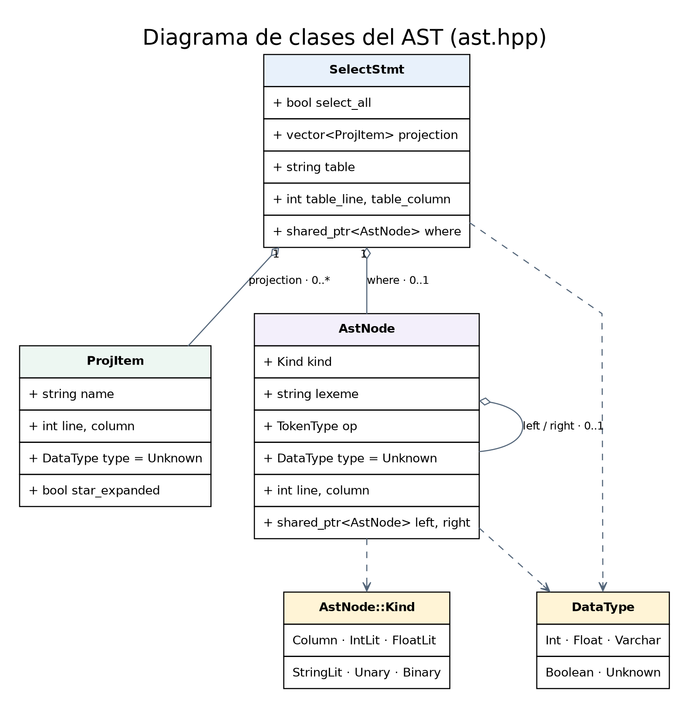

# Esquema de Traducción Dirigida por la Sintaxis (SDT) y AST — Lab 6

Documento de diseño del Lab 6: cómo las producciones LL(1) del Lab 5 construyen el AST y
cómo el analizador semántico lo resuelve y decora con tipos.

## 1. Construcción del AST a partir de la derivación LL(1)

El parser LL(1) (no recursivo, por pila) produce una **derivación por la izquierda**:
la secuencia de producciones aplicadas (`ParseResult::derivation`) y los tokens
emparejados en orden (`ParseResult::matched`). El constructor `buildAst`
(`ast_builder.cpp`) recorre esa derivación con una función por no terminal, de modo que
cada producción tiene una **regla semántica** asociada. Este es el SDT: atributos
**sintetizados** (el subárbol que devuelve cada no terminal) y **heredados** (el subárbol
izquierdo que una cola recibe para asociar a la izquierda).

### Atributos y reglas de traducción

La tabla especifica el SDT sobre la gramática de
[`grammar.md`](../parser_ll1/grammar.md). Los atributos `.val` son sintetizados. `.in` es
heredado y transporta el árbol acumulado por una cola recursiva. Los terminales token
exponen `lexeme`, `type`, `line` y `column`.

Notación: `Item(t)` construye un `ProjItem` desde un identificador; `Column(t)` y
`Literal(k,t)` construyen hojas; `Unary(t,x)` y `Binary(t,x,y)` construyen nodos con el
operador y la posición del token `t`. Todos los nodos y elementos de proyección comienzan
con tipo `Unknown`. `Projection(All)` y `Projection(List)` representan conceptualmente las
dos formas de proyección que luego se guardan en `SelectStmt`.

| Producción | Atributos | Ecuaciones semánticas |
|---|---|---|
| `consulta → KEYWORD_SELECT proyeccion KEYWORD_FROM IDENTIFIER where_opt SEMICOLON` | `consulta.val` sintetizado: `SelectStmt` | `consulta.val = SelectStmt(proyeccion.val, IDENTIFIER.lexeme, IDENTIFIER.line, IDENTIFIER.column, where_opt.val)` |
| `proyeccion → STAR` | `proyeccion.val` sintetizado: `Projection` | `proyeccion.val = Projection(All)` |
| `proyeccion → lista_cols` | `proyeccion.val` sintetizado: `Projection` | `proyeccion.val = Projection(List(lista_cols.val))` |
| `lista_cols → IDENTIFIER cols_tail` | `lista_cols.val` sintetizado: lista de `ProjItem` | `lista_cols.val = [Item(IDENTIFIER)] ++ cols_tail.val` |
| `cols_tail → COMMA IDENTIFIER cols_tail₁` | `cols_tail.val` sintetizado: lista de `ProjItem` | `cols_tail.val = [Item(IDENTIFIER)] ++ cols_tail₁.val` |
| `cols_tail → ε` | `cols_tail.val` sintetizado | `cols_tail.val = []` |
| `where_opt → KEYWORD_WHERE condicion` | `where_opt.val` sintetizado: `AstNode` opcional | `where_opt.val = condicion.val` |
| `where_opt → ε` | `where_opt.val` sintetizado | `where_opt.val = null` |
| `condicion → disy` | `condicion.val` sintetizado | `condicion.val = disy.val` |
| `disy → conj disy_tail` | `disy_tail.in` heredado; `disy.val` sintetizado | `disy_tail.in = conj.val`; `disy.val = disy_tail.val` |
| `disy_tail → KEYWORD_OR conj disy_tail₁` | `disy_tail.in` heredado; `.val` sintetizado | `disy_tail₁.in = Binary(KEYWORD_OR, disy_tail.in, conj.val)`; `disy_tail.val = disy_tail₁.val` |
| `disy_tail → ε` | `disy_tail.in` heredado; `.val` sintetizado | `disy_tail.val = disy_tail.in` |
| `conj → comp conj_tail` | `conj_tail.in` heredado; `conj.val` sintetizado | `conj_tail.in = comp.val`; `conj.val = conj_tail.val` |
| `conj_tail → KEYWORD_AND comp conj_tail₁` | `conj_tail.in` heredado; `.val` sintetizado | `conj_tail₁.in = Binary(KEYWORD_AND, conj_tail.in, comp.val)`; `conj_tail.val = conj_tail₁.val` |
| `conj_tail → ε` | `conj_tail.in` heredado; `.val` sintetizado | `conj_tail.val = conj_tail.in` |
| `comp → suma comp_tail` | `comp_tail.in` heredado; `comp.val` sintetizado | `comp_tail.in = suma.val`; `comp.val = comp_tail.val` |
| `comp_tail → op_comp suma` | `comp_tail.in` heredado; `.val` sintetizado | `comp_tail.val = Binary(op_comp.val, comp_tail.in, suma.val)` |
| `comp_tail → ε` | `comp_tail.in` heredado; `.val` sintetizado | `comp_tail.val = comp_tail.in` |
| `op_comp → EQUAL \| NOT_EQUAL \| LESS \| GREATER \| LESS_EQUAL \| GREATER_EQUAL` | `op_comp.val` sintetizado: token operador | `op_comp.val = token emparejado` |
| `suma → prod suma_tail` | `suma_tail.in` heredado; `suma.val` sintetizado | `suma_tail.in = prod.val`; `suma.val = suma_tail.val` |
| `suma_tail → PLUS prod suma_tail₁` | `suma_tail.in` heredado; `.val` sintetizado | `suma_tail₁.in = Binary(PLUS, suma_tail.in, prod.val)`; `suma_tail.val = suma_tail₁.val` |
| `suma_tail → MINUS prod suma_tail₁` | `suma_tail.in` heredado; `.val` sintetizado | `suma_tail₁.in = Binary(MINUS, suma_tail.in, prod.val)`; `suma_tail.val = suma_tail₁.val` |
| `suma_tail → ε` | `suma_tail.in` heredado; `.val` sintetizado | `suma_tail.val = suma_tail.in` |
| `prod → unario prod_tail` | `prod_tail.in` heredado; `prod.val` sintetizado | `prod_tail.in = unario.val`; `prod.val = prod_tail.val` |
| `prod_tail → STAR unario prod_tail₁` | `prod_tail.in` heredado; `.val` sintetizado | `prod_tail₁.in = Binary(STAR, prod_tail.in, unario.val)`; `prod_tail.val = prod_tail₁.val` |
| `prod_tail → SLASH unario prod_tail₁` | `prod_tail.in` heredado; `.val` sintetizado | `prod_tail₁.in = Binary(SLASH, prod_tail.in, unario.val)`; `prod_tail.val = prod_tail₁.val` |
| `prod_tail → ε` | `prod_tail.in` heredado; `.val` sintetizado | `prod_tail.val = prod_tail.in` |
| `unario → MINUS unario` | `unario.val` sintetizado | `unario.val = Unary(MINUS, unario₁.val)` (el subíndice distingue la ocurrencia recursiva del lado derecho) |
| `unario → primario` | `unario.val` sintetizado | `unario.val = primario.val` |
| `primario → IDENTIFIER` | `primario.val` sintetizado | `primario.val = Column(IDENTIFIER)` |
| `primario → INTEGER_LITERAL` | `primario.val` sintetizado | `primario.val = Literal(IntLit, INTEGER_LITERAL)` |
| `primario → DECIMAL_LITERAL` | `primario.val` sintetizado | `primario.val = Literal(FloatLit, DECIMAL_LITERAL)` |
| `primario → STRING_LITERAL` | `primario.val` sintetizado | `primario.val = Literal(StringLit, STRING_LITERAL)` |
| `primario → LPAREN condicion RPAREN` | `primario.val` sintetizado | `primario.val = condicion.val` (los paréntesis no crean nodo) |

En las colas, cada nueva operación envuelve el acumulador izquierdo y pasa el resultado a
la siguiente cola. Por ejemplo, `a - b - c` se traduce como
`Binary(MINUS, Binary(MINUS, a, b), c)`. La misma regla establece la asociatividad a la
izquierda para `OR`, `AND`, suma y producto; la jerarquía de no terminales conserva la
precedencia definida por la gramática. `comp_tail` no se recursa, por lo que admite una
sola comparación.

### Correspondencia con la implementación

Estas ecuaciones especifican los valores semánticos de forma abstracta; no son acciones
insertadas en las producciones del parser. El parser LL(1) guarda los identificadores de
producción en `ParseResult::derivation` y los tokens reconocidos en `ParseResult::matched`.
Después, `buildAst()` consume ambas secuencias en paralelo. `Builder::buildDisyTail()`,
`buildConjTail()`, `buildSumaTail()` y `buildProdTail()` reciben el acumulador como parámetro
y aplican las ecuaciones heredadas. Las listas de proyección se agregan directamente a
`SelectStmt::projection`, equivalente al valor de lista descrito aquí; los tipos se
resuelven posteriormente en `analyze()`.

## 2. Diagrama de clases del AST (`ast.hpp`)

El diagrama refleja las tres estructuras declaradas en `ast.hpp`. `SelectStmt` contiene
cero o más elementos `ProjItem` y una raíz `AstNode` opcional para `WHERE`. Cada `AstNode`
puede apuntar a hijos `left` y `right` mediante `std::shared_ptr`; el nodo distingue su
forma con `AstNode::Kind` (`Column`, `IntLit`, `FloatLit`, `StringLit`, `Unary` o `Binary`).
Los tipos de `ProjItem` y `AstNode` comienzan como `DataType::Unknown` y el analizador
semántico los actualiza al decorar el árbol. `TokenType op` guarda el operador cuando el
nodo es unario o binario. Las posiciones se almacenan como línea y columna en cada
proyección, en la tabla de `SelectStmt` y en cada nodo.

## 3. Reglas semánticas (verificación)

1. **FROM**: la tabla debe existir en el catálogo.
2. **Resolución de columnas** (SELECT y WHERE): cada columna debe pertenecer a la tabla.
3. **Expansión de `*`**: `SELECT *` se reemplaza por la lista ordenada (por ordinal) de
   columnas de la tabla, cada una con su tipo.
4. **Duplicados**: columnas repetidas en la proyección → **advertencia** (política del
   equipo: se advierte, la consulta sigue válida).
5. **Tipos en WHERE** (con `Int`/`Float` como numéricos y promoción entre ellos):
   - `-` unario y aritméticos `+ - * /`: operandos numéricos; resultado `Float` si alguno
     es `Float`, si no `Int`.
   - Igualdad `= <>`: tipos compatibles (numérico-numérico, o ambos del mismo tipo:
     `Varchar`-`Varchar`, `Boolean`-`Boolean`). Resultado `Boolean`.
   - Orden `< > <= >=`: solo numérico-numérico. Resultado `Boolean`.
   - Lógicos `AND OR`: ambos operandos `Boolean`. Resultado `Boolean`.
   - La condición completa del `WHERE` debe evaluar a `Boolean`.

Cada violación produce un `SemDiag` con mensaje, línea y columna. El análisis no inicia
si hubo errores léxicos o sintácticos, y nunca provoca un crash.
